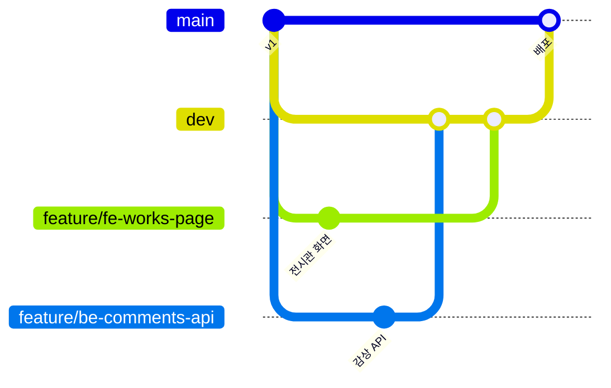

# 같이 작업하는 법 (Frontend · Backend 한 레포)

PART는 **한 저장소 안에서 폴더로 프론트와 백엔드를 나눠요.** 저장소를 둘로 쪼개지 않는 이유:
- Cloudflare 배포 한 번(`wrangler deploy`)으로 화면 파일과 서버가 같이 올라가요.
- API를 바꿀 때 프론트·백엔드 수정을 **한 PR**에 같이 담을 수 있어요(어긋날 일이 적음).

## 폴더 = 담당

| 폴더 | 담당 | 내용 |
|---|---|---|
| `frontend/` | FE | HTML, CSS, 브라우저 JS, 디자인 사진 |
| `backend/` | BE | Cloudflare Worker(API), DB 표(migrations) |
| `shared/` | 둘 다 | 양쪽이 같이 쓰는 값 (분야 목록) |
| `scripts/` | 둘 다 | 테스트 |
| `docs/` | 둘 다 | 설명서 |

PR을 올리면 바꾼 폴더에 따라 `frontend` / `backend` / `shared` / `docs` **라벨이 자동으로** 붙어요.

## 브랜치 전략



| 브랜치 | 용도 | 규칙 |
|---|---|---|
| `main` | **배포용**. 여기에 들어가면 Cloudflare에 자동 배포 | 직접 push 금지, PR + CI 통과만 |
| `dev` | 통합. 기능을 모아서 같이 확인 | PR + CI 통과 |
| `feature/fe-<할일>` | 화면 작업 | `dev`에서 따서 `dev`로 PR |
| `feature/be-<할일>` | 서버 작업 | 〃 |
| `fix/<무엇>` | 버그 수정 | 급하면 `main`으로 바로 PR 가능 |

### 하루 작업 순서

```bash
git switch dev && git pull                 # 1. 최신 dev 받기
git switch -c feature/fe-profile-photo     # 2. 내 브랜치 만들기
# … 코드 수정 …
npm test                                   # 3. 테스트
git add -A && git commit -m "feat(fe): 프로필 사진 표시"
git push -u origin feature/fe-profile-photo
gh pr create --base dev                    # 4. dev로 PR (템플릿이 자동으로 뜸)
```

### 커밋 메시지

`종류(범위): 내용` — 범위는 `fe` / `be` / `shared` / `docs`

```
feat(fe): 전시관 페이지 분리
fix(be): 이메일 대소문자 구분 없이 로그인
docs: 배포 방법 추가
```

## 프론트·백엔드 약속 (API)

프론트와 백엔드가 만나는 곳은 **`/api/...` 주소와 JSON 모양**뿐이에요.

1. API를 바꾸는 사람은 `README.md`의 **API 요약 표**를 같이 고쳐요.
2. 응답에 필드를 **추가**하는 건 괜찮지만, **이름 바꾸기·삭제**는 프론트와 같은 PR에서 해요.
3. 오류는 항상 `{ "error": "사용자에게 보여 줄 문구" }` + 상태 코드(400·401·403·404·409·429)로 보내요.
4. 분야처럼 양쪽이 같은 값을 써야 하면 `shared/`에 두고 양쪽에서 불러요.

## PR 전에 확인

```bash
npm run check   # 모든 JS 문법 검사
npm test        # 로컬 Cloudflare(D1·R2)를 띄워 가입~탈퇴까지 59가지 확인
```

CI(GitHub Actions)도 같은 두 명령을 돌려요. 빨간 X가 뜨면 머지할 수 없어요.
