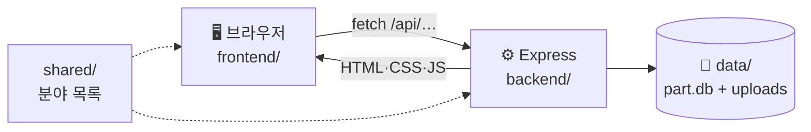

# PART — Project + Art

> 학생이 만든 프로젝트를 링크 대신 **작품처럼 걸어 두는** 학교 전시관.

수행평가로 만든 웹페이지·게임·도구를 카드로 걸고, 친구들은 써 보고 ▲ 응원과 한 줄 감상을 남깁니다.
작품을 걸면 단톡방·인스타에 바로 붙여 넣을 홍보 문구도 만들어 줍니다.

- 화면: HTML · CSS · 바닐라 JavaScript (프레임워크 없음)
- 서버: Node.js + Express
- DB: SQLite (`better-sqlite3`, 파일 하나 `part.db`)

## 바로 실행하기

Node.js 20 이상이 필요해요.

```bash
npm install
npm start          # → http://localhost:3000
npm run dev        # 코드를 고치면 서버가 자동으로 다시 켜져요
npm test           # 임시 DB로 가입~삭제까지 자동 확인
```

처음 실행하면 `data/` 폴더에 `part.db`가 만들어지고 빈 전시관에서 시작해요.
가입 → 작품 걸기 → 홍보 키트 순서로 눌러 보면 전체 흐름을 볼 수 있어요.

## 한눈에 보기



📘 **자세한 그림 설명: [docs/WORKFLOW.md](docs/WORKFLOW.md)** · 🚂 배포: [docs/DEPLOY.md](docs/DEPLOY.md) · 🤝 같이 작업하기: [CONTRIBUTING.md](CONTRIBUTING.md) · 🔰 코드 해설(초보자용): [EXPLAIN.md](EXPLAIN.md)

## 기능

| 구분 | 기능 |
|---|---|
| 계정 | 이메일 + 비밀번호 가입·로그인, 로그아웃, 회원 탈퇴, 닉네임·소개 수정 |
| 작품 | 등록(사진 5장, 분야, 기술 태그, GitHub), 수정, 삭제, 비공개 |
| 둘러보기 | 홈(이번 주의 작품 + 최근 6개), 전시관(검색·분야·인기순/최신순 전체 목록) |
| 반응 | ▲ 응원(로그인, 1인 1회), 한 줄 감상(로그인 없이, 작품 주인이 삭제 가능) |
| 알리기 | 홍보 키트(단톡방·인스타·한 줄 문구 복사), 작품 주소 복사 |
| 화면 | 어두운 화면 기본 + 밝은 화면 전환, 모바일 대응 |

## 페이지

| 주소 | 화면 |
|---|---|
| `/` | 홈 — 히어로, 이번 주의 작품, 최근 작품 6개, 사용법 |
| `/works.html` | 전시관 — 전체 작품 (검색·분야·정렬, 주소에 조건 저장) |
| `/project.html?id=` | 작품 상세 — 이야기, 추천 대상, 화면, 방명록 |
| `/edit.html` | 작품 걸기 / 고치기 (`?id=`) — 입력하는 대로 미리보기 |
| `/kit.html?id=` | 홍보 키트 |
| `/login.html`, `/signup.html` | 한 칸씩 입력하는 로그인·가입 |
| `/profile.html?id=` | 프로필 — 내 정보 수정, 걸어 둔 작품 |

## 폴더 구조

```
frontend/                 화면 (FE 담당)
  index.html  works.html  project.html  edit.html  kit.html
  login.html  signup.html profile.html
  js/app.js               모든 화면이 같이 쓰는 함수 (api 호출, 메뉴, 카드, 응원, 한 칸 입력 폼)
  style.css               디자인 — 포인트색은 맨 위 --accent
  img/                    디자인 사진 (CC0)
backend/                  서버 (BE 담당)
  server.js               시작점: 세션·정적 파일·API 연결
  config.js               포트·비밀키·데이터 폴더 (환경변수)
  session-store.js        로그인 세션을 SQLite에 저장
  db.js  schema.sql       DB 연결·테이블·예전 DB 업그레이드
  routes/auth.js          /api/signup, /login, /logout, /me, /users/:id
  routes/projects.js      /api/projects 목록·상세·등록·수정·삭제, /like, /comments
shared/categories.js      분야 목록 (프론트·백엔드 공용)
scripts/smoke-test.js     npm test
data/                     DB와 업로드 사진 (git에는 안 올라감, 배포에선 볼륨)
docs/                     WORKFLOW(그림 설명), DEPLOY(배포)
.github/                  CI, PR 라벨 자동, PR 템플릿
```

## API 요약

| 메서드 | 주소 | 설명 | 로그인 |
|---|---|---|---|
| POST | `/api/signup` | `{email, password, nickname}` | |
| POST | `/api/login` | `{email, password}` | |
| POST | `/api/logout` | | |
| GET / PUT / DELETE | `/api/me` | 내 정보 / 닉네임·소개 수정 / 탈퇴 | ✔ (GET 제외) |
| GET | `/api/users/:id` | 공개 프로필 | |
| GET | `/api/projects?q=&cat=&sort=hot\|new&user=` | 작품 목록 | |
| GET | `/api/projects/:id` | 작품 상세 | |
| POST / PUT / DELETE | `/api/projects[/:id]` | 등록 / 수정 / 삭제 (multipart, `images` 5장) | ✔ 본인 |
| POST | `/api/projects/:id/like` | ▲ 응원 켜기·끄기 | ✔ |
| GET / POST | `/api/projects/:id/comments` | 한 줄 감상 보기 / 남기기 (IP당 1분 5개) | |
| DELETE | `/api/projects/:id/comments/:cid` | 감상 지우기 | ✔ 작품 주인 |

## 인터넷에 올릴 때

Railway에 올려요. `main` 브랜치에 머지하면 자동 배포되고, DB·사진은 볼륨(`/data`)에 남아요.
환경변수 `SECRET`, `DATA_DIR=/data`, `NODE_ENV=production`이 필요해요. 단계별 방법은 **[docs/DEPLOY.md](docs/DEPLOY.md)**.

## 브랜치

`main`(배포) ← `dev`(통합) ← `feature/fe-…`, `feature/be-…`. 자세한 규칙은 [CONTRIBUTING.md](CONTRIBUTING.md).

## 출처

사진: Unsplash, StockSnap, rawpixel (CC0)
