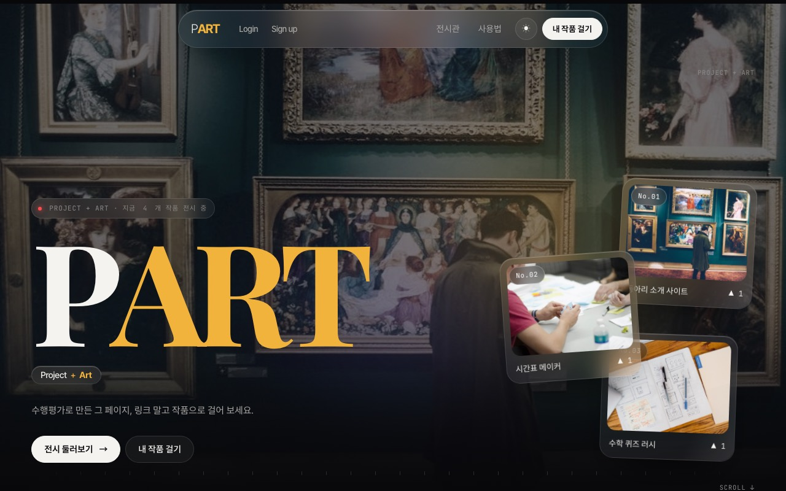
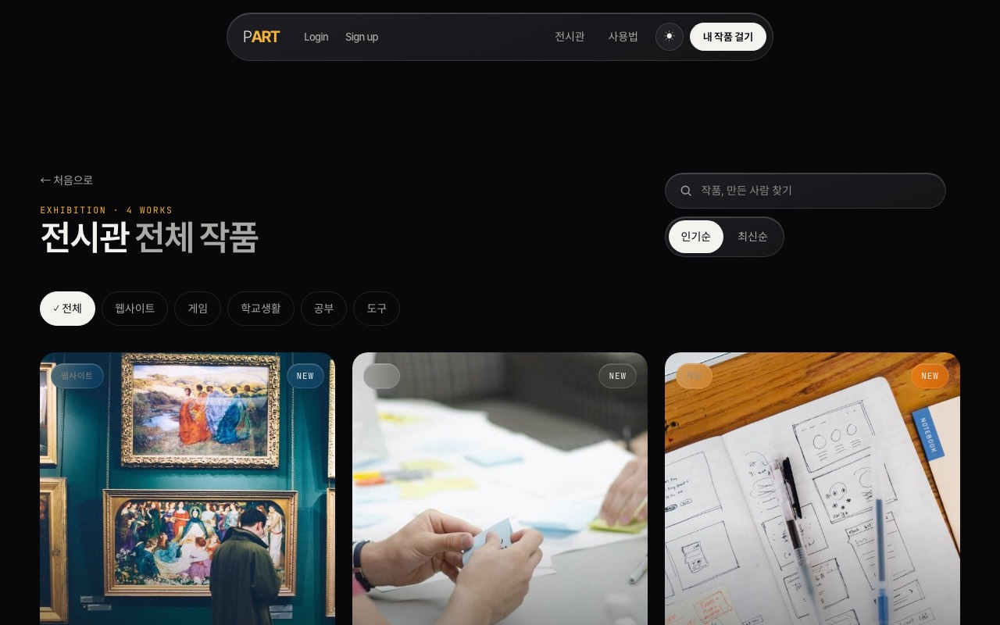
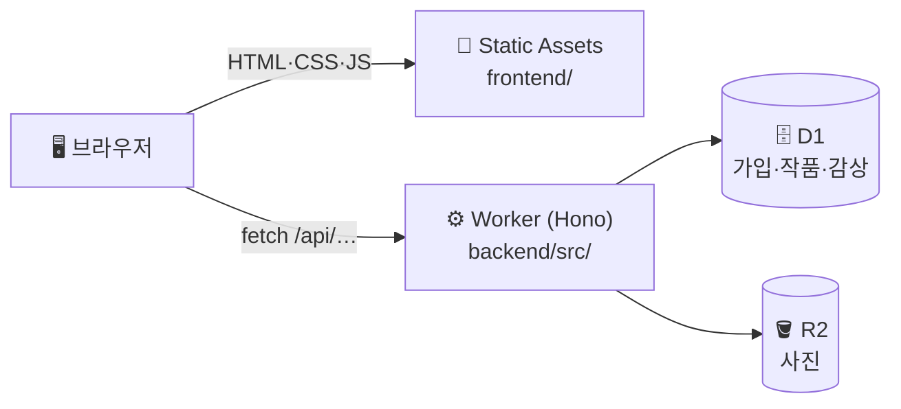

<div align="center">

# 🖼️ PART

**학생 프로젝트를 걸어 두는 온라인 전시관**

수행평가로 만든 웹페이지·게임·도구를 링크 대신 **작품처럼** 걸어 두고,<br/>
친구들은 써 보고 ▲ 응원과 한 줄 감상을 남겨요.

[](https://github.com/10x4hs/p-art/actions/workflows/ci.yml)


### 👉 [**p-art.swx2.workers.dev** 에서 전시 보러 가기](https://p-art.swx2.workers.dev)

</div>

---

## 📸 화면

| 홈 | 전시관 (검색·분야·정렬) |
|---|---|
|  |  |

<sub>어두운 테마, 1280×800 · 로컬에서 샘플 작품 4개를 걸어 두고 찍었어요.</sub>

## ✨ 무엇을 할 수 있나요

| 기능 | 설명 |
|---|---|
| 🔐 가입·로그인 | 이메일 + 비밀번호로 가입하고 로그인·로그아웃·탈퇴해요 |
| 🖼️ 작품 걸기 | 사진(최대 5장)·분야·기술 태그·GitHub 주소를 넣어 걸고, 고치거나 지우거나 비공개로 돌려요 |
| 🔎 갤러리·검색 | 전시관에서 제목·소개·태그·만든 사람으로 검색하고, 분야 필터와 인기순/최신순 정렬을 해요 |
| 🏛️ 전시 페이지 | 작품마다 만든 이야기, 추천 대상, 화면 사진, 체험 링크를 한 페이지에 보여 줘요 |
| ▲ 응원 | 로그인한 사람은 작품마다 **1인 1회** 응원을 켜고 끌 수 있어요 |
| 💬 방명록 | 로그인 없이 한 줄 감상을 남기고, 작품 주인은 감상을 지울 수 있어요 |
| 📣 홍보 키트·링크 공유 | 단톡방·인스타용 홍보 문구와 작품 주소를 버튼 한 번에 복사해요 |
| 👥 팀원 지정 | 함께 만든 친구(최대 5명)를 닉네임으로 찾아 넣으면, 작품 페이지와 친구 프로필에 같이 보여요 |
| 📝 임시 저장 | 작품을 쓰는 동안 글자 칸이 브라우저에 자동 저장돼서, 창을 닫아도 이어 쓸 수 있어요 |
| 🪟 사이트 미리보기 | 작품 페이지의 **미리보기** 버튼으로 체험 사이트를 페이지 안에서 바로 열어 봐요 |
| ★ 북마크 | 마음에 드는 작품을 북마크하고, 내 프로필의 **모아 보기**에서 다시 찾아요 |
| 🔗 공유 미리보기 | 작품 주소를 카톡·SNS에 붙이면 그 작품의 제목·소개·사진이 미리보기로 떠요 (Open Graph) |
| 📊 전시 통계 | 내 작품의 조회·응원·감상·북마크 수를 작품 페이지와 프로필에서 봐요 |
| 🚩 신고·숨김 | 서로 다른 3명이 신고하면 작품이 자동으로 가려지고, 관리자가 `/admin.html`에서 확인해 숨기거나 되살려요 |
| 👤 프로필 | 닉네임·소개를 고치고, 내가 걸어 둔 작품과 함께 만든 작품을 한곳에서 봐요 |
| 🌗 밝은/어두운 테마 | 어두운 화면이 기본이고, ☀ 버튼으로 밝은 화면으로 바꿔요 (선택은 기억돼요) |

## 🧭 구조



자세한 흐름은 [docs/WORKFLOW.md](docs/WORKFLOW.md)에 그림으로 설명돼 있어요.

## 🚀 빠른 시작

Node.js 20 이상만 있으면 돼요. Cloudflare 계정은 **없어도** 돼요 (내 컴퓨터에 가짜 D1·R2를 만들어서 돌려요).

```bash
npm ci          # 패키지 설치
npm run dev     # 로컬 DB 준비 후 → http://localhost:8787
npm test        # 임시 DB로 가입~탈퇴까지 자동 확인
```

배포는 손으로 하지 않아요. **`main`에 머지되면** GitHub Actions가 테스트 → DB 업데이트 → 배포까지 자동으로 해요. ([docs/DEPLOY.md](docs/DEPLOY.md))

## 📁 폴더 구조

```
frontend/              화면 — HTML 페이지들, style.css, js/app.js(공용 함수), img/
backend/src/           서버 — Hono Worker 시작점(index.js), 로그인·비밀번호 도구, og.js(공유 미리보기)
backend/src/routes/    API — auth.js(가입·로그인), projects.js(작품·응원·북마크·감상·신고), admin.js(관리)
backend/migrations/    DB 표 구조 (SQL)
shared/                프론트·백엔드가 같이 쓰는 분야 목록
scripts/smoke-test.js  npm test 로 도는 자동 확인
docs/                  설명서 (WORKFLOW, DEPLOY, CODE-REVIEW, 스크린샷)
wrangler.jsonc         Cloudflare 설정 (D1·R2 연결, 정적 파일)
.github/               CI, 자동 배포, PR 템플릿
```

## 👥 팀

| 이름 | 역할 | 맡은 일 |
|---|---|---|
| 김예준 | PM · PL | 기획, 일정, 전체 관리 |
| 김서율 | Frontend | 공통 UI · 갤러리 · 검색 · 프로필 |
| 김가은 | Frontend | 카드 · 로그인 · 등록 폼 · 전시 페이지 |
| 한지석 | Backend | API · DB · 로그인 · 업로드 |

## 📚 문서

- 🗺️ [docs/WORKFLOW.md](docs/WORKFLOW.md) — 전체 흐름 그림 설명
- 🚂 [docs/DEPLOY.md](docs/DEPLOY.md) — 배포와 무료 한도
- 🔍 [docs/CODE-REVIEW.md](docs/CODE-REVIEW.md) — 코드 리뷰 가이드
- 🔰 [EXPLAIN.md](EXPLAIN.md) — 초보자용 코드 해설
- 🤝 [CONTRIBUTING.md](CONTRIBUTING.md) — 브랜치·PR 규칙, 같이 작업하기

<div align="center"><sub>사진: Unsplash, StockSnap, rawpixel (CC0)</sub></div>
