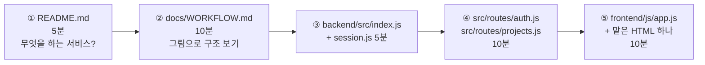
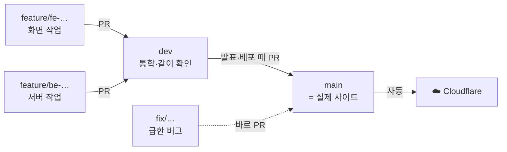

# PART 코드 리뷰 가이드

팀원이 코드를 **보고, 이해하고, 의견을 남기는** 방법이에요.
"왜 이렇게 나눴지?"에 대한 답을 먼저 읽고 코드를 보면 훨씬 빨리 이해돼요.

---

## 1. 코드 보는 곳

| 방법 | 어떻게 |
|---|---|
| 실제 사이트 | https://p-art.swx2.workers.dev |
| 웹에서 보기 | https://github.com/10x4hs/p-art (공개 저장소, 로그인 없이 볼 수 있어요) |
| **줄마다 댓글 달기** | **리뷰 전용 PR** → 저장소의 *Pull requests* 탭에서 `[리뷰 전용]`으로 시작하는 PR → *Files changed* 탭 |
| 내 컴퓨터에서 돌려 보기 | `git clone https://github.com/10x4hs/p-art && cd p-art && npm install && npm run dev` → http://localhost:8787 |

> 리뷰 전용 PR은 "아무것도 없는 상태 → 지금 코드"를 비교하게 만들어 둔 거라서, **모든 파일의 모든 줄**에 댓글을 달 수 있어요. 머지하지 않아요.

---

## 2. 읽는 순서 (약 40분)



모르는 문법이 나오면 [EXPLAIN.md](../EXPLAIN.md)의 **키워드 사전**을 보세요.

### 나눠서 보기 (사람 수에 맞게)

| 담당 | 볼 파일 | 특히 볼 것 |
|---|---|---|
| 백엔드 A | `backend/src/index.js`, `session.js`, `password.js`, `util.js`, `migrations/`, `wrangler.jsonc` | 주소 나누기·로그인 유지·암호화·DB 표 |
| 백엔드 B | `backend/src/routes/auth.js`, `routes/projects.js` | 입력 검사, 권한(남의 작품을 고칠 수 없는지) |
| 프론트 A | `frontend/js/app.js`, `index.html`, `works.html` | 공통 함수, 목록·검색 |
| 프론트 B | `project.html`, `edit.html`, `kit.html`, `login.html`, `signup.html`, `profile.html` | 화면 흐름, 오류 문구 |
| 공통 | `shared/`, `scripts/smoke-test.js`, `.github/` | 테스트가 무엇을 확인하는지 |

---

## 3. 왜 파일을 이렇게 나눴나요?

```
p-art/
├─ frontend/   화면 — Cloudflare가 그대로 보내는 파일
├─ backend/    서버 — Cloudflare Worker (브라우저는 코드를 못 봄)
├─ shared/     둘 다 쓰는 값
├─ scripts/    자동 테스트
├─ docs/       설명서
└─ wrangler.jsonc  Cloudflare 연결 설정 (D1·R2·정적 파일)
```

| 결정 | 이유 | 다른 선택지와 왜 안 골랐는지 |
|---|---|---|
| **한 저장소에 frontend/·backend/ 폴더로 나눔** | `wrangler deploy` 한 번에 화면과 서버가 같이 올라감. API를 바꿀 때 화면 수정도 같은 PR에 담을 수 있음 | 저장소 2개: 배포 2번, 버전 맞추기 어려움. 폴더 구분 없음: 누가 어디를 고치는지 헷갈림 |
| **frontend/는 Cloudflare가 그대로 내려줌** | 빌드 과정 없이 HTML 열면 바로 보임. 수행평가 조건(HTML·CSS·JS) | React/Vite: 배울 게 많고 빌드 단계가 생김 |
| **backend/src/ 안에서 역할별 파일** | `index.js`=조립, `session.js`=로그인 기억, `password.js`=암호화, `util.js`=공용 도구, `routes/`=기능 | 한 파일에 몰기: 처음엔 편하지만 300줄 넘으면 찾기 어려움 |
| **routes/를 auth와 projects로** | 주소 앞부분(`/api/…`, `/api/projects/…`)과 파일이 1:1 → 주소만 보고 파일을 찾음 | 기능마다 파일(likes.js, comments.js…): 지금 규모엔 파일이 너무 잘게 쪼개짐 |
| **shared/categories.json** | 분야 목록을 화면과 서버가 같이 읽음 → 한쪽만 고쳐서 생기는 버그 방지 | 양쪽에 복사: 실제로 그렇게 했다가 이 문제 때문에 합침 |
| **Cloudflare (Workers + D1 + R2)** | 카드 없이 무료, 배포해도 데이터 유지, 전 세계 어디서나 빠름 | Railway: 무료 체험 끝나 월 $5. Render 무료: 재배포 때 데이터 사라짐 |
| **migrations/ 폴더** | DB 표를 바꾼 기록이 파일로 남고, 배포 때 순서대로 자동 적용 | 손으로 SQL 실행: 내 컴퓨터와 실제 DB가 달라지기 쉬움 |
| **D1 (SQLite)** | 처음 만든 SQLite SQL을 거의 그대로 사용. 학교 규모엔 충분 | MySQL/Postgres: 별도 서버·비용 필요 |
| **사진은 R2 + 브라우저에서 줄이기** | 파일 저장 전용이라 사진에 알맞고, 무료 한도(10GB, 쓰기 월 100만 번)가 넉넉함. 줄여서 올리면 더 아낌 | KV: 처음엔 이걸 썼지만 쓰기가 하루 1,000번뿐이라 2026-11에 R2로 바꿈 |
| **Hono** | Express와 문법이 거의 같고 Cloudflare에서 바로 돌아감 | Express: Workers에서 그대로 돌리기 어려움 |
| **app.js에 공통 함수** | 카드·메뉴·응원 버튼을 한 곳에서 → 모양을 바꾸면 모든 페이지에 적용 | 페이지마다 복사: 고칠 곳이 8군데 |

---

## 4. 왜 브랜치를 이렇게 했나요?



| 결정 | 이유 |
|---|---|
| **`main` = 배포** | main에 들어가는 순간 실제 사이트가 바뀜. 그래서 가장 엄격하게 보호 |
| **`dev`를 하나 더 둠** | 여러 사람 작업을 먼저 합쳐 보고, 같이 돌려 본 다음 main으로. 반쯤 된 기능이 사이트에 나가는 걸 막음 |
| **`feature/fe-…`, `feature/be-…`** | 이름만 봐도 누가 어느 쪽을 고치는지 앎. 각자 브랜치라 서로 작업을 덮어쓰지 않음 |
| **직접 push 금지, PR만** | 모든 변경이 PR로 남아서 리뷰·기록이 됨 |
| **CI 통과해야 머지** | 사람이 놓쳐도 자동 테스트 59개가 가입~신고~탈퇴를 매번 확인 |
| **승인 0명** | 학생 팀이라 리뷰어가 없어도 막히지 않게. 대신 리뷰는 약속으로 (아래 5번) |
| **PR 라벨 자동** | 바꾼 폴더를 보고 `frontend`/`backend`가 붙어서, 내 담당 PR만 골라 볼 수 있음 |

> 더 단순하게 main 하나만 쓰는 방법도 있어요(GitHub Flow). 사람이 2명 이하면 그게 더 편하고, 3명 이상이 동시에 작업하면 지금 방식이 덜 부딪혀요.

---

## 5. 리뷰할 때 볼 것 (체크리스트)

**이해**
- [ ] 이 파일/함수가 하는 일을 한 문장으로 말할 수 있나요? 못 하겠으면 **질문 댓글**을 남겨요 (그것도 좋은 리뷰예요)
- [ ] 이름(변수·함수)만 보고 뜻을 알 수 있나요?

**동작**
- [ ] 빈 값, 아주 긴 값, 이상한 값을 넣으면 어떻게 되나요?
- [ ] 로그인 안 한 사람, **남의 작품**을 고치려는 사람은 막히나요?
- [ ] 화면 검사만 있고 서버 검사는 없는 곳이 있나요?

**안전**
- [ ] 사용자가 쓴 글을 화면에 넣을 때 `esc()`를 썼나요?
- [ ] SQL에 값을 넣을 때 `?`나 `@이름`을 썼나요? (글자 이어 붙이기 ✗)
- [ ] 비밀번호·비밀키가 코드에 그대로 적혀 있지 않나요?

**구조**
- [ ] 같은 코드가 여러 곳에 복사돼 있나요? → `app.js`나 `shared/`로 옮길 수 있나요?
- [ ] 화면 일인데 backend에, 서버 일인데 frontend에 있지 않나요?

---

## 6. 댓글 다는 법

**GitHub에서**: 리뷰 전용 PR → *Files changed* → 줄 번호 옆 **+** 클릭 → 댓글 → *Start a review* → 다 달면 오른쪽 위 *Finish your review*.

**댓글 앞에 종류를 붙여요** — 받는 사람이 급한 정도를 바로 알 수 있게:

| 머리말 | 뜻 | 예 |
|---|---|---|
| `질문:` | 이해가 안 돼요 | `질문: 왜 DELETE를 먼저 하고 INSERT를 하나요?` |
| `버그:` | 이렇게 하면 고장 나요 | `버그: 제목에 공백만 넣으면 저장돼요` |
| `제안:` | 이렇게 바꾸면 더 좋아요 | `제안: 이 숫자 6을 이름 있는 상수로` |
| `칭찬:` | 이건 잘했어요 | `칭찬: 실패 문구를 하나로 합친 거 좋아요` |
| `사소:` | 고쳐도 되고 안 고쳐도 돼요 | `사소: 오타 '거는' → '걸는'?` |

**좋은 댓글의 조건**
- 사람이 아니라 **코드**에 대해 말해요 ("너 틀렸어" ✗ → "이 줄은 빈 값일 때 …" ✓)
- **왜**를 같이 적어요 ("바꿔 주세요" ✗ → "바꾸면 …가 막혀요" ✓)
- 고치는 방법을 알면 같이 적어요

---

## 7. 리뷰 다음엔?

1. 고칠 게 정해지면 **이슈**로 만들어요 (리뷰 댓글 → `…` → *Reference in new issue*)
2. 담당자가 `feature/…` 또는 `fix/…` 브랜치에서 고쳐서 `dev`로 PR
3. 그 PR에서 다시 짧게 리뷰 → CI 통과 → 머지
