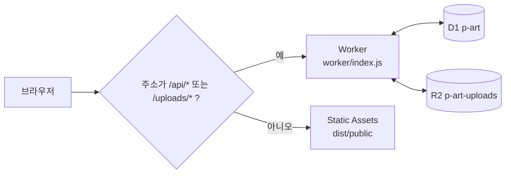

# Cloudflare에 올리기

배포 주소: **https://p-art.swx2.workers.dev**

Cloudflare Workers에서는 Express·SQLite 파일·사진 폴더를 그대로 쓸 수 없어서, 같은 API를 `worker/index.js`로 옮겨 두었어요.

| Railway(`backend/`) | Cloudflare(`worker/`) |
|---|---|
| Express 서버 | Worker (`worker/index.js`) |
| `part.db` (SQLite 파일) | D1 데이터베이스 `p-art` |
| `uploads/` 폴더 | R2 버킷 `p-art-uploads` |
| `express.static(frontend)` | Static Assets (`frontend/` + `shared/` → `dist/public/`) |
| bcrypt 비밀번호 | PBKDF2(SHA-256) — Workers 내장 암호화 |
| express-session | D1 `sessions` 표 + `sid` 쿠키 |



## 다시 배포하기

```bash
npx wrangler login     # 처음 한 번
npm run cf:deploy      # DB 마이그레이션 적용 + 빌드 + 배포
```

## 내 컴퓨터에서 돌려 보기

```bash
npx wrangler d1 migrations apply p-art --local   # 처음 한 번
npm run cf:dev                                   # http://localhost:8787
BASE_URL=http://localhost:8787 npm test          # 같은 스모크 테스트로 확인
```

## DB 스키마를 바꿀 때

`worker/migrations/0002_….sql`처럼 **새 파일**을 추가하세요. 이미 적용된 파일을 고치면 원격 DB에는 반영되지 않아요.

## 알아 둘 점

- Railway용 `backend/`도 그대로 남아 있어요. API를 바꾸면 **두 곳을 같이** 고쳐야 해요.
- 두 버전은 비밀번호 저장 방식이 달라서 계정 데이터를 서로 옮길 수 없어요.
- 로그: `npx wrangler tail` 또는 Cloudflare 대시보드 → Workers → p-art → Logs.
