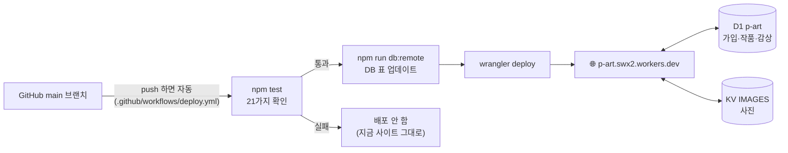

# Cloudflare에 올리기

PART는 **Cloudflare 무료 요금제**에서 돌아가요.

- 사이트: **https://p-art.swx2.workers.dev**
- 카드 등록 없이 무료이고, 서버가 쉬어도 데이터는 사라지지 않아요.

| 역할 | Cloudflare 기능 | 이름 |
|---|---|---|
| 서버 (API) | Workers | `p-art` |
| 화면 파일 | Workers 정적 파일 (Static Assets) | `frontend/` 폴더 |
| DB | D1 (SQLite) | `p-art` |
| 사진 | KV | `IMAGES` |



## 무료 한도 (하루 기준)

| 항목 | 무료 한도 | PART에서 쓰이는 곳 |
|---|---|---|
| Workers 요청 | 100,000번 | API 호출 (화면 파일은 따로 무제한) |
| Workers CPU | 요청당 10ms | 그래서 비밀번호를 PBKDF2(빠른 기본 기능)로 암호화 |
| D1 읽기 / 쓰기 | 500만 줄 / 10만 줄 | 목록·가입·감상 |
| D1 저장 | 5GB | |
| KV 쓰기 | **1,000번** | **사진 한 장 = 1번** → 하루 사진 약 1,000장까지 |
| KV 저장 | 1GB | 사진은 브라우저에서 줄여서(장당 약 100~300KB) 올림 |

학교 규모에서는 넉넉해요. 한도를 넘으면 그날만 해당 기능이 오류를 내고, 다음 날 다시 돼요.

---

## 이미 해 둔 것

1. Cloudflare 계정에 D1 `p-art`, KV `IMAGES`를 만들었어요. 둘의 id는 `wrangler.jsonc`에 들어 있어요(비밀값 아님).
2. DB 표를 만들었어요(`backend/migrations/0001_init.sql`).
3. 첫 배포를 해서 https://p-art.swx2.workers.dev 가 열려요.

## GitHub에서 자동 배포 켜기 (한 번만)

`main`에 머지될 때마다 자동으로 배포되게 하려면, GitHub가 Cloudflare에 배포할 수 있는 **열쇠(API 토큰)**가 필요해요.

1. https://dash.cloudflare.com/profile/api-tokens → **Create Token**
2. **Edit Cloudflare Workers** 템플릿 → *Use template*
3. *Permissions*에 한 줄 추가: **Account → D1 → Edit**
4. *Account Resources*: 내 계정, *Zone Resources*: All zones → **Continue → Create Token**
5. 나온 토큰을 복사해서 GitHub 저장소에 등록:
   ```bash
   gh secret set CLOUDFLARE_API_TOKEN -R 10x4hs/p-art
   # 붙여넣고 Enter
   ```
   (또는 GitHub → Settings → Secrets and variables → Actions → New repository secret)

> 토큰은 **비밀번호와 같아요.** 채팅·코드·스크린샷에 붙이지 마세요.

## 손으로 배포하기 (내 컴퓨터에서)

```bash
npx wrangler login     # 처음 한 번 (브라우저에서 허용)
npm run deploy         # DB 표 업데이트 + 배포
```

## DB 표를 바꿀 때

1. `backend/migrations/`에 **새 파일**을 만들어요: `0002_무엇을.sql` (기존 파일은 고치지 않아요)
2. `npm run dev`를 실행하면 내 컴퓨터 DB에 먼저 적용돼요.
3. main에 머지하면 배포할 때 실제 DB에도 적용돼요(`npm run db:remote`).

## 확인 · 문제 해결

| 하고 싶은 것 | 명령 |
|---|---|
| 실시간 로그 보기 | `npx wrangler tail` |
| 실제 DB 들여다보기 | `npx wrangler d1 execute p-art --remote --command "SELECT COUNT(*) FROM users"` |
| 배포 기록 | `npx wrangler deployments list` |
| 이전 버전으로 되돌리기 | `npx wrangler rollback` |

| 증상 | 확인 |
|---|---|
| GitHub Actions의 Deploy가 빨간 X, `Authentication error` | `CLOUDFLARE_API_TOKEN` 시크릿과 D1 Edit 권한 |
| 로그인이 계속 풀림 | 주소가 `https://`인지 (쿠키는 https에서만 안전 모드로 저장) |
| 사진이 안 올라감 + `KV put() limit exceeded` | 오늘 KV 쓰기 1,000번을 다 씀 → 내일 다시 |
| `Error 1102: Worker exceeded resource limits` | CPU 10ms 초과 → `wrangler tail`로 어느 API인지 확인 |
