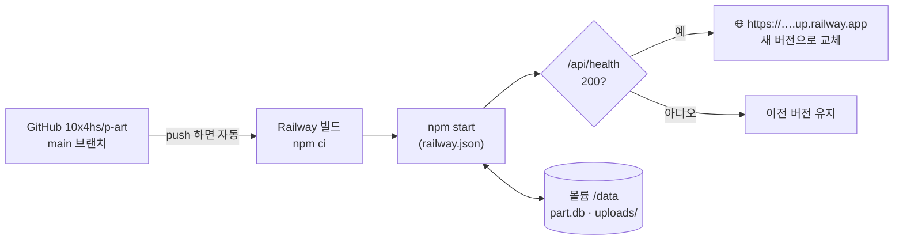

# Railway에 올리기

PART는 **서버(Express) + DB 파일(SQLite) + 사진 폴더**가 계속 살아 있어야 해서, 정적 호스팅(Vercel 정적·GitHub Pages)이 아니라 **디스크(볼륨)를 붙일 수 있는 서버 호스팅**이 필요해요. Railway를 써요.



## 처음 한 번 (약 10분)

1. **가입**: https://railway.com → *Login with GitHub* (10x4hs 저장소에 접근 허용)
2. **프로젝트 만들기**: *New Project* → *Deploy from GitHub repo* → `10x4hs/p-art` 선택
   - 배포 브랜치: **`main`** (Settings → Source에서 확인)
3. **볼륨 붙이기** (데이터가 사라지지 않게 — 가장 중요)
   - 서비스 화면에서 우클릭 또는 `⌘K` → *Attach Volume* → Mount path: **`/data`**
4. **환경변수** (서비스 → *Variables*)

   | 이름 | 값 | 이유 |
   |---|---|---|
   | `SECRET` | 길고 무작위한 문자열 (터미널에서 `openssl rand -hex 32`) | 로그인 쿠키 서명. 없으면 서버가 일부러 안 켜져요 |
   | `DATA_DIR` | `/data` | DB와 사진을 볼륨에 저장 |
   | `NODE_ENV` | `production` | https 전용 쿠키 등 배포 설정 켜기 |

   `PORT`는 Railway가 알아서 넣어 줘요.
5. **주소 만들기**: *Settings → Networking → Generate Domain* → `https://p-art-production.up.railway.app` 같은 주소가 생겨요.
6. 주소로 들어가서 가입 → 작품 걸기까지 해 보기.

## 그다음부터

- `main`에 머지되면 **자동으로 다시 배포**돼요. 볼륨의 DB·사진은 그대로 남아요.
- 새 버전이 `/api/health`에 응답하지 못하면 Railway가 **이전 버전을 계속 돌려요**.
- 로그: 서비스 → *Deployments* → 해당 배포 → *View Logs*. 시작할 때 `PART → … (data: /data)`가 보이면 볼륨이 제대로 붙은 거예요.

## 비용

체험 크레딧 이후 Hobby 플랜(월 $5, 사용량 포함)이면 이 정도 서비스는 충분해요. 볼륨은 쓴 만큼(1GB 기준 매우 적음).

## 백업

볼륨의 `part.db` 하나가 모든 데이터예요. 서비스 → Volume → *Backups*에서 백업을 만들어 두세요.

## 문제 해결

| 증상 | 확인 |
|---|---|
| 배포 후 바로 꺼짐, 로그에 `SECRET 환경변수가 없어요` | Variables에 `SECRET` 추가 |
| 재배포하면 가입 정보가 사라짐 | 볼륨이 `/data`에 붙어 있고 `DATA_DIR=/data`인지 |
| 로그인이 안 되고 계속 풀림 | 주소가 `https://`인지 (`NODE_ENV=production`이면 https에서만 쿠키 동작) |
| 사진이 안 보임 | 로그의 `data:` 경로와 볼륨 경로가 같은지 |

## 내 컴퓨터에서 배포 환경 흉내내기

```bash
SECRET=test NODE_ENV=production DATA_DIR=./data-prod npm start
```
(`NODE_ENV=production`이면 쿠키가 https에서만 동작해서 localhost에서는 로그인이 안 되는 게 정상이에요.)
