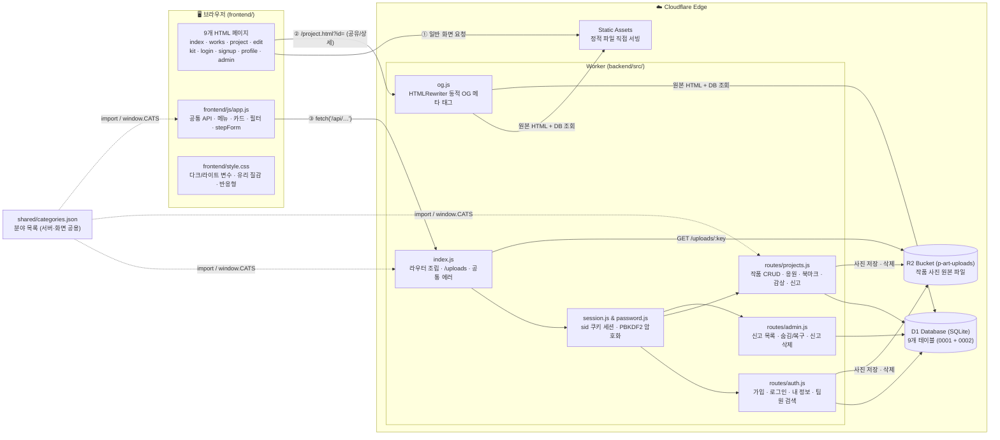
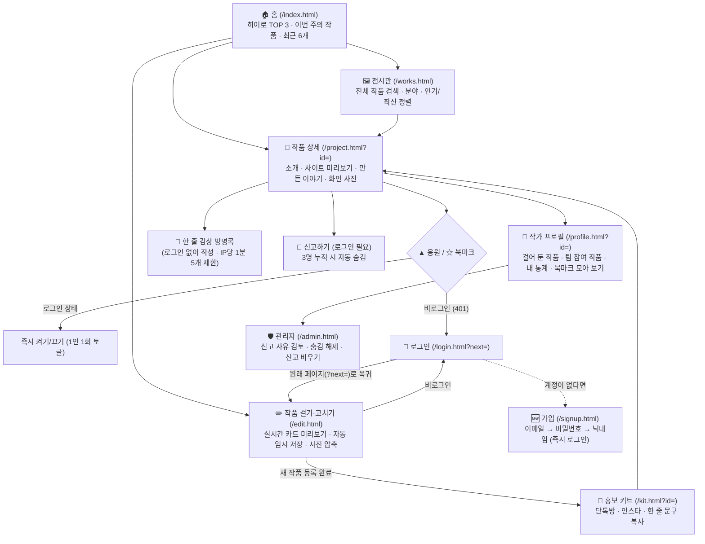
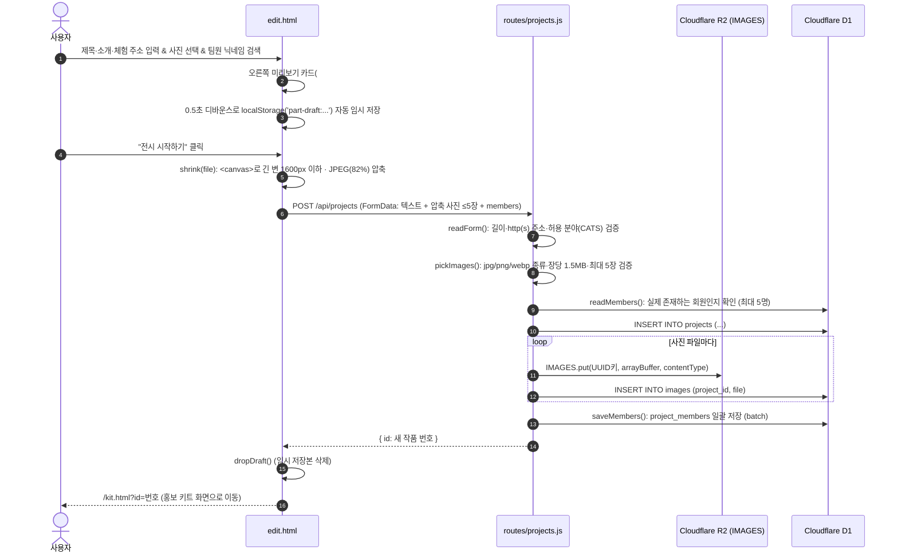
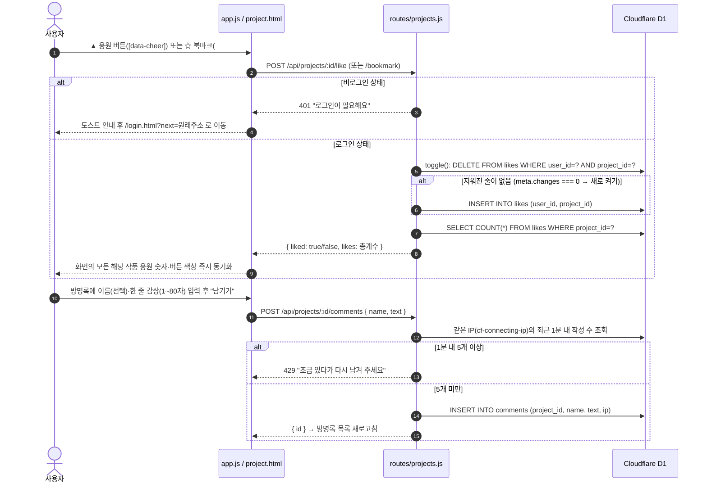
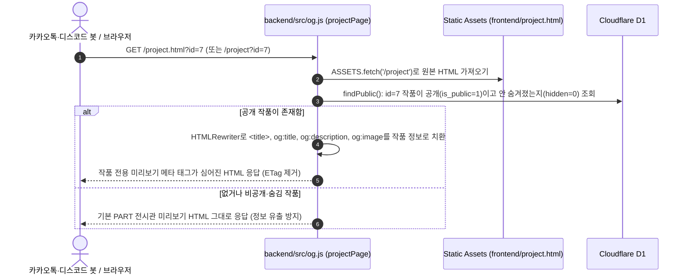
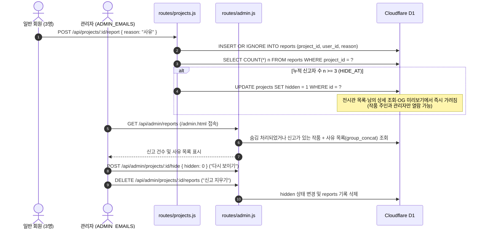
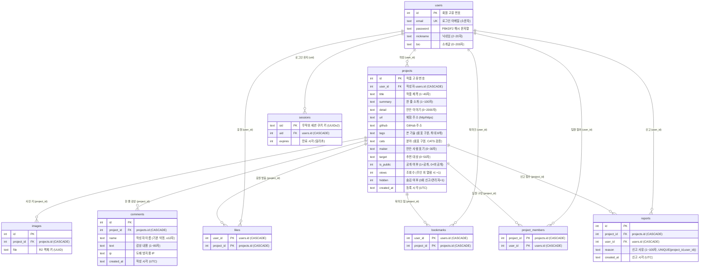
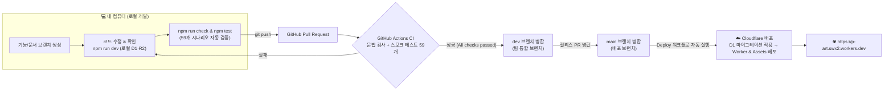

# PART 워크플로 & 아키텍처 시각화 가이드

> 팀원이 프로젝트 전체 구조와 데이터의 흐름을 **한눈에 그림으로 이해**할 수 있도록 정리한 문서예요.
> GitHub에서 이 파일을 열면 모든 Mermaid 다이어그램이 자동으로 선명하게 렌더링돼요.
> 코드 한 줄 한 줄에 대한 상세 해설은 [EXPLAIN.md](../EXPLAIN.md)를 함께 참고해 주세요.

- [1. 전체 시스템 아키텍처](#1-전체-시스템-아키텍처)
- [2. 페이지 이동 및 사용자 여정 (User Flow)](#2-페이지-이동-및-사용자-여정-user-flow)
- [3. 핵심 기능별 시퀀스 다이어그램 (Sequence Diagrams)](#3-핵심-기능별-시퀀스-다이어그램-sequence-diagrams)
  - [3-1. 회원가입 · 로그인 · 세션 쿠키](#3-1-회원가입--로그인--세션-쿠키)
  - [3-2. 작품 걸기 (클라이언트 사진 압축 + R2 업로드 + 팀원 지정)](#3-2-작품-걸기-클라이언트-사진-압축--r2-업로드--팀원-지정)
  - [3-3. ▲ 응원 · ☆ 북마크 · 💬 한 줄 감상 (도배 방지)](#3-3--응원---북마크---한-줄-감상-도배-방지)
  - [3-4. 카카오톡·SNS 공유 미리보기 (동적 Open Graph 치환)](#3-4-카카오톡sns-공유-미리보기-동적-open-graph-치환)
  - [3-5. 🚩 신고 3회 자동 숨김 & 관리자 검토](#3-5--신고-3회-자동-숨김--관리자-검토)
- [4. 데이터베이스 구조 (ERD · 전체 9개 테이블)](#4-데이터베이스-구조-erd--전체-9개-테이블)
- [5. 개발 · 테스트 · CI/CD 자동 배포 파이프라인](#5-개발--테스트--cicd-자동-배포-파이프라인)
- [6. 무엇을 바꾸려면 어느 파일을 고치나요? (빠른 길찾기 표)](#6-무엇을-바꾸려면-어느-파일을-고치나요-빠른-길찾기-표)

---

## 1. 전체 시스템 아키텍처



> [!TIP]
> **왜 정적 자산(Static Assets)과 Worker를 나누었나요?**
> 일반 HTML·CSS·JS 파일은 Worker를 거치지 않고 Cloudflare 정적 자산 서버가 바로 내려주어 속도가 빠르고 무료 요청 한도를 아껴요.
> 반면 `/api/*`, `/uploads/*`, `/shared/*`, 그리고 카톡 공유 미리보기가 필요한 `/project`, `/project.html`만 `wrangler.jsonc`의 `run_worker_first` 설정을 통해 Worker가 먼저 처리해요.

---

## 2. 페이지 이동 및 사용자 여정 (User Flow)



---

## 3. 핵심 기능별 시퀀스 다이어그램 (Sequence Diagrams)

### 3-1. 회원가입 · 로그인 · 세션 쿠키

```mermaid
sequenceDiagram
  autonumber
  actor U as 사용자
  participant F as signup.html / login.html<br/>(stepForm)
  participant A as routes/auth.js
  participant P as password.js / session.js
  participant DB as Cloudflare D1

  U->>F: 이메일 → 비밀번호 → 닉네임 한 칸씩 입력
  F->>F: 단계별 정규식 검사 (이메일 형식, 영문+숫자 8자↑, 닉네임 2~20자)
  F->>A: POST /api/signup { email, password, nickname }
  A->>A: 서버 재검증 + 이메일 소문자 변환(cleanEmail)
  A->>DB: SELECT 1 FROM users WHERE email = ?
  alt 이미 가입된 이메일 (409 Conflict)
    A-->>F: 409 "이미 가입한 이메일이에요"
    F-->>U: stepForm.goTo(0) → 1단계(이메일 칸)로 자동 복귀
  else 신규 이메일
    A->>P: hashPassword(password) (16B 무작위 소금 + PBKDF2 100,000회)
    A->>DB: INSERT INTO users (email, password, nickname)
    A->>P: startSession(c, uid)
    P->>DB: batch: 만료 세션 DELETE + 새 sid(30일) INSERT
    P-->>F: Set-Cookie: sid=...; HttpOnly; SameSite=Lax + 내 정보 JSON
    F-->>U: "가입 완료" → /edit.html 이동
  end
```

---

### 3-2. 작품 걸기 (클라이언트 사진 압축 + R2 업로드 + 팀원 지정)



---

### 3-3. ▲ 응원 · ☆ 북마크 · 💬 한 줄 감상 (도배 방지)



---

### 3-4. 카카오톡·SNS 공유 미리보기 (동적 Open Graph 치환)



---

### 3-5. 🚩 신고 3회 자동 숨김 & 관리자 검토



---

## 4. 데이터베이스 구조 (ERD · 전체 9개 테이블)



---

## 5. 개발 · 테스트 · CI/CD 자동 배포 파이프라인



---

## 6. 무엇을 바꾸려면 어느 파일을 고치나요? (빠른 길찾기 표)

| 바꾸고 싶은 것 | 고칠 파일 | 담당 |
| :--- | :--- | :--- |
| 화면 문구 · 배치 · 레이아웃 구조 | `frontend/*.html` | FE |
| 색상 테마 · 폰트 · 카드/버튼 디자인 | `frontend/style.css` (`:root`, `:root.light` 변수 등) | FE |
| 모든 페이지 공통 상단 메뉴 · 카드 모양 · 응원 클릭 동작 | `frontend/js/app.js` (`nav()`, `card()`, `filters()`, `stepForm()`) | FE |
| 홈 화면에 보이는 최대 작품 개수 | `frontend/index.html` (`HOME_LIMIT = 6`) | FE |
| 작품 등록 직후 나오는 홍보 문구 템플릿 | `frontend/kit.html` (`promos()`) | FE |
| 업로드 전 사진 리사이즈 해상도·품질 | `frontend/edit.html` (`shrink(file, 1600)`) | FE |
| 작품 분야(카테고리) 추가·변경 | `shared/categories.json` (**이 파일 한 곳만 고치면 서버·화면 모두 자동 반영!**) | 공용 |
| 카톡·SNS 공유 미리보기(Open Graph) 제목·이미지 규칙 | `backend/src/og.js` (`projectPage()`) | BE |
| 관리자 이메일 지정 | `wrangler.jsonc`의 `vars.ADMIN_EMAILS` (쉼표로 구분) | BE |
| 입력 글자 수 제한 · 검색/필터 SQL · 자동 숨김 신고 횟수(`HIDE_AT`) | `backend/src/routes/projects.js`, `backend/src/routes/auth.js` | BE |
| 데이터베이스 표·열 추가 | `backend/migrations/`에 새 `0003_....sql` 파일 추가 | BE |
| 자동화 테스트 시나리오 추가 | `scripts/smoke-test.js` (`npm test`) | 공용 |
