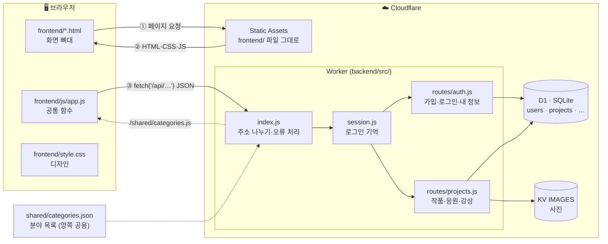
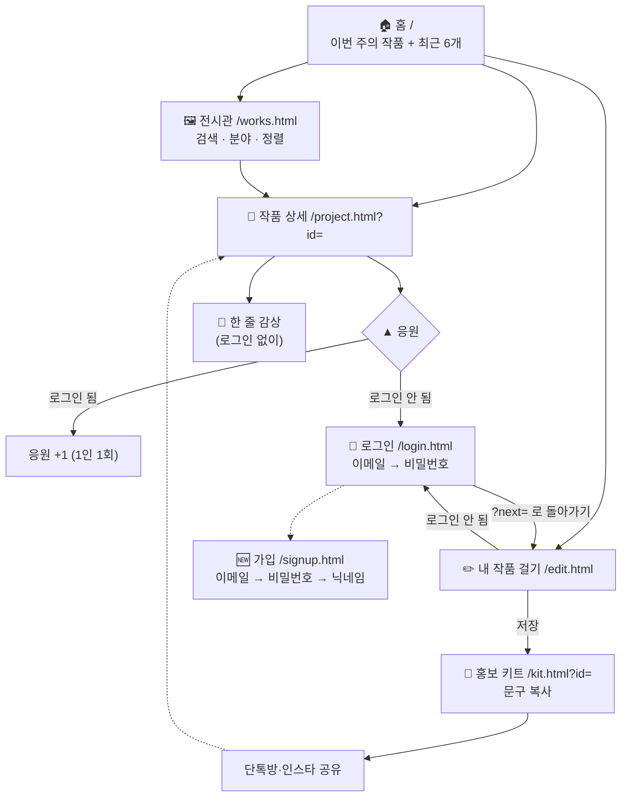
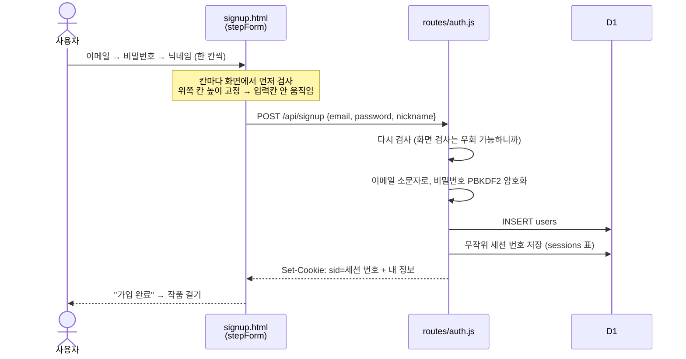
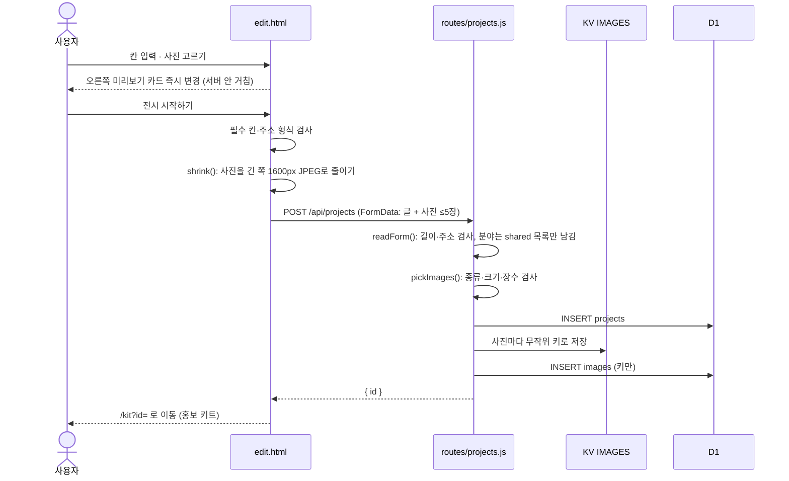
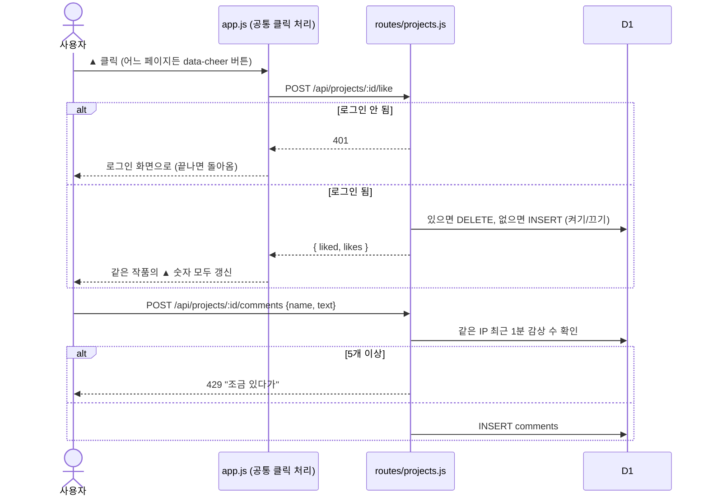
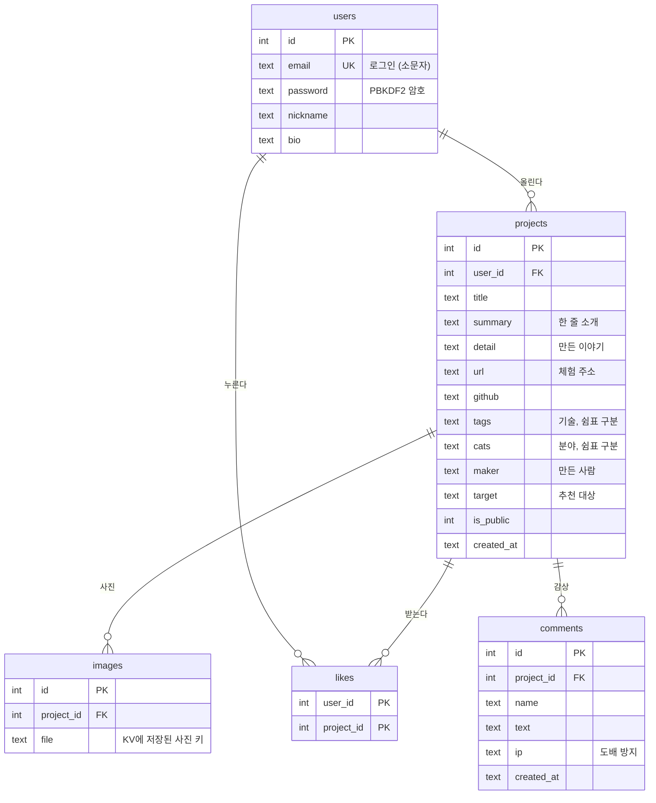
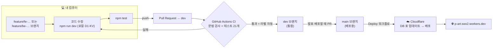

# PART는 어떻게 돌아가나요?

팀원이 코드를 처음 열었을 때 **무엇이 어디서 어떻게 움직이는지** 그림으로 이해하도록 만든 문서예요.
(GitHub에서 열면 아래 그림이 자동으로 그려져요.)

- [1. 전체 구조](#1-전체-구조)
- [2. 사용자 흐름](#2-사용자-흐름)
- [3. 기능별 흐름 (시퀀스)](#3-기능별-흐름)
- [4. DB 구조](#4-db-구조)
- [5. 개발 → 배포 흐름](#5-개발--배포-흐름)
- [6. 무엇을 바꾸려면 어디를?](#6-무엇을-바꾸려면-어디를)

---

## 1. 전체 구조

**핵심은 두 단계예요.**
1. 화면 파일(`frontend/`)은 Cloudflare가 **그대로** 보내요. Worker를 거치지 않아서 빠르고 무료 한도도 안 써요.
2. 페이지가 열리면 `app.js`가 `/api/...`를 불러요. 이 주소만 Worker(`backend/src/`)가 처리해서 **데이터만** 돌려줘요.

어떤 주소를 Worker가 먼저 처리할지는 `wrangler.jsonc`의 `run_worker_first`(`/api/*`, `/uploads/*`, `/shared/*`)가 정해요.
그래서 **보이는 것**은 `frontend/`, **저장·규칙**은 `backend/src/`에서 고쳐요.

> Cloudflare는 주소에서 `.html`을 떼어 줘요 (`/project.html?id=1` → `/project?id=1`). 둘 다 같은 페이지예요.

---

## 2. 사용자 흐름

---

## 3. 기능별 흐름

### 3-1. 가입 · 로그인

- 로그인 상태 = **쿠키 속 세션 번호(sid) → D1 sessions 표 → uid**. 배포해도 유지(30일, 쓸 때마다 연장).
- 비밀번호 원문은 어디에도 저장되지 않아요. PBKDF2를 쓰는 이유: Workers 무료 요금제는 요청당 CPU 10ms 제한이 있는데, bcrypt(순수 JS)는 100ms쯤 걸려요. PBKDF2는 Cloudflare 기본 기능이라 훨씬 빨라요.

### 3-2. 작품 걸기

- 사진은 KV에, DB에는 **키(이름)만** 있어요. 화면은 `/uploads/키`로 사진을 불러요 → Worker가 KV에서 꺼내 보내요.
- 사진을 브라우저에서 줄이는 이유: KV 무료 한도(1GB, 하루 쓰기 1,000번)를 아끼고, 휴대폰 사진(5~10MB)도 빨리 올라가게.

### 3-3. ▲ 응원 · 💬 한 줄 감상

### 3-4. 목록 (홈 · 전시관)

---

## 4. DB 구조

- 사용자를 지우면 작품·응원이, 작품을 지우면 사진·응원·감상이 **함께 지워져요**(`ON DELETE CASCADE`).
- 로그인 세션은 `sessions` 표(sid, uid, expires)에 있어요.
- 표 구조는 `backend/migrations/0001_init.sql`. 바꿀 땐 **새 파일**(`0002_….sql`)을 추가해요 → 배포할 때 자동 적용.

---

## 5. 개발 → 배포 흐름

- `npm run dev`는 **내 컴퓨터 안에 가짜 D1·KV**를 만들어서 돌려요. 실제 사이트 데이터는 건드리지 않아요.

브랜치 규칙은 [CONTRIBUTING.md](../CONTRIBUTING.md), 배포 방법은 [DEPLOY.md](DEPLOY.md)에 있어요.

---

## 6. 무엇을 바꾸려면 어디를?

| 하고 싶은 것 | 고칠 곳 | 담당 |
|---|---|---|
| 화면 문구·배치 | `frontend/*.html` | FE |
| 색 · 글꼴 | `frontend/style.css` 맨 위 변수 (`--accent` 등) | FE |
| 카드 모양 (모든 페이지 공통) | `frontend/js/app.js`의 `card()` | FE |
| 홈에 보이는 작품 수 | `frontend/index.html`의 `HOME_LIMIT` | FE |
| 홍보 문구 | `frontend/kit.html`의 `promos()` | FE |
| 분야 추가·변경 | `shared/categories.json` **한 곳만** | 공용 |
| 입력 규칙(길이 등) | `backend/src/routes/*.js` + 화면 쪽 검사도 같이 | BE+FE |
| 새 API | `backend/src/routes/`에 추가 → `index.js`에서 `app.route` → API 표 갱신 | BE |
| 사진 크기·장수 | 화면 `edit.html`의 `shrink()` + 서버 `projects.js`의 `MAX_BYTES`·`MAX_FILES` | FE+BE |
| Worker가 먼저 처리할 주소 | `wrangler.jsonc`의 `run_worker_first` | BE |
| 테이블 구조 | `backend/migrations/`에 새 `000N_….sql` 추가 | BE |
